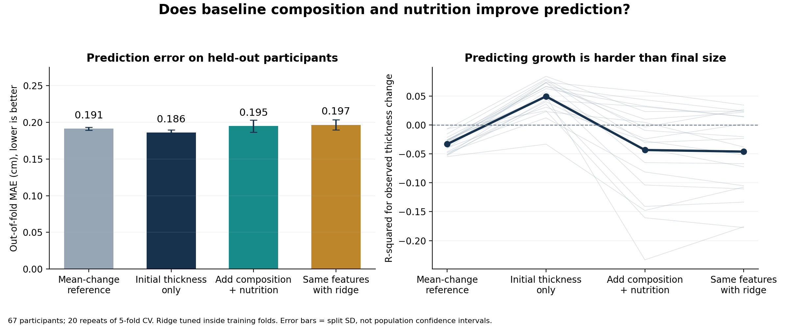

# Muscle Hypertrophy Response Modeling and Prediction

Reproducible secondary analysis of public longitudinal resistance-training data from Mobley et al. (2018). The question is whether baseline body composition, protein and energy intake add information beyond initial muscle thickness about thickness after 12 weeks of training.

**Finding:** In this 67-participant sample, adding baseline composition, protein and energy did not improve held-out prediction beyond initial muscle thickness. This is not evidence that nutrition has no physiological effect.

| Fixed model | Mean held-out MAE (cm) | Mean POST R² | Mean change R² |
|---|---:|---:|---:|
| Initial thickness only | 0.1861 | 0.457 | 0.049 |
| Add lean mass, fat mass, protein and energy | 0.1949 | 0.404 | -0.043 |
| Same five predictors, tuned ridge | 0.1966 | 0.403 | -0.046 |

Scores summarize 20 repeats of 5-fold participant-level CV; ridge is tuned within training data. Repeats reuse the same people and do not increase the independent sample size. Split variability is not a population confidence interval.



This repository includes the [English research report](reports/Hypertrophy_Research_Report_FINAL_EN.pdf), [Chinese research report](reports/Hypertrophy_Research_Report_FINAL_CN.pdf), [Chinese interpretation guide](docs/PROJECT_EXPLANATION_CN.md), [model card](MODEL_CARD.md), and [reproducibility notes](docs/REPRODUCIBILITY.md). The original study already examined hypertrophic responses; this project focuses on reproducible processing and a declared incremental prediction question. The protocol was written after reading the publication, before fitting new models; it was not a registered preregistration. No external-validation or personal-prescription claim is made.

## Reproduce

Python 3.12 is recommended; it matches the validated user-side environment. From the repository root, create a virtual environment, then run:

```bash
python -m pip install -r requirements.txt
python src/run_models.py
# Optional: rerun the independent checks on the exported outputs
python src/verify_models.py
```

Both scripts resolve paths relative to their own location and require no account credentials. `run_eda.py` verifies the raw XLSX checksum, keeps 67 real participants, preserves missing values, validates the derived muscle thickness change, and regenerates Stage 1 data, tables, figures and the Chinese report. `run_models.py` recreates Stage 1 first, then fits declared baseline-adjusted association models, checks HC3 by independent delete-one least-squares fits, runs the same 20 x 5 participant-level CV splits for all models, and tunes ridge using inner training-only validation. Raw-source summary rows never enter the analysis. Each CV repeat yields one held-out prediction per person and model; repeated predictions are not new independent participants.

For Windows users with Python 3.12, open PowerShell in this project folder. If this project folder has no virtual environment yet, run `python -m venv .venv` first. Then:

```powershell
.\.venv\Scripts\python.exe -m pip install -r requirements.txt
.\.venv\Scripts\python.exe src\run_models.py
```

Do not run from `C:\Windows\system32`. Run the next command only after the preceding command succeeds. A virtual environment is not included in the ZIP.

## Files

- `data/raw/mobley_2018_s2_raw.xlsx`: unmodified public S2 dataset.
- `data/source_manifest.json`: DOI, download URL, checksum, selection rule, runtime and quality checks.
- `data/processed/participants_core.csv`: 67 participants with 26 traceable core/derived columns.
- `data/processed/participants_all_source_columns.csv`: original participant-level variables, plus original Excel row number. Original transformations and cluster labels are preserved for provenance but excluded from planned baseline prediction.
- `data/processed/core_data_dictionary.csv`: original column, clean name, unit, timing, role and completeness.
- `data/processed/source_column_missingness.csv`: counts based on real participant rows only.
- `results/descriptive_summary.csv` and `results/eda_summary.json`: actual descriptive statistics.
- `results/Step1_EDA_Report_CN.md`: Chinese explanation and limitations.
- `figures/`: muscle thickness, body composition and baseline nutrition plots. The main figure also has an SVG copy.
- `docs/analysis_protocol.md`: fixed variables, comparator models, time availability, planned validation and interpretation limits.
- `src/run_eda.py`: complete Stage 1 cleaning and EDA pipeline.
- `src/run_models.py`: declared association models, influence diagnostics and leakage-controlled model validation.
- `src/verify_models.py`: independent split/metric checks and a closed-form reproduction of the first nested ridge search. This is also run automatically by `run_models.py`.
- `docs/stage2_implementation.md`: implementation choices fixed before the new models ran.
- `results/models/`: coefficients, CV metrics, participant-level predictions, outer and inner splits, ridge choices, diagnostics and English/Chinese reports.
- `figures/04_model_comparison.png`, `05_association_coefficients.png`, `06_model_diagnostics.png`: Stage 2 figures.
- `src/build_report.py`, `src/build_report_cn.py` and `requirements-report.txt`: optional English/Chinese PDF builders and their dependency. Core modeling does not require the report dependency.

## Important definitions

`T1` means PRE and `T39` means POST (12 weeks), not week 39. Ultrasound vastus lateralis thickness is in cm. Nutrition fields are self-reported intake in g/day or kcal/day from 4-day food logs. DXA lean mass is not synonymous with skeletal muscle mass. Supplement codes remain categorical identifiers because the name mapping has not been verified. Do not compute protein g/kg body weight without a real, matched body-weight measurement.

The dataset has no non-training control or independent repeated training cycles. Variation in observed changes is not sufficient to classify stable biological responders. All participants are young previously untrained men, and results cannot automatically generalize to other populations.

## Attribution and licensing

Original data: Christopher B. Mobley, Cody T. Haun, Paul A. Roberson, Petey W. Mumford, Wesley C. Kephart, Matthew A. Romero, Shelby C. Osburn, Christopher G. Vann, Kaelin C. Young, Darren T. Beck, Jeffrey S. Martin, Christopher M. Lockwood and Michael D. Roberts (2018). PLOS ONE 13(4):e0195203, S2 File: Raw data. https://doi.org/10.1371/journal.pone.0195203

Original publication and data are attributed under CC BY 4.0: https://creativecommons.org/licenses/by/4.0/. Cleaning, renaming and analytical figures in this package are derived analyses of that dataset; the raw file is unmodified. Retain this citation when redistributing or publishing. The original data authors did not write `run_eda.py` or `run_models.py`. These scripts were newly developed for this project with AI assistance; no original-author analysis code was copied. Users should review the code and describe their own contributions accurately. Code and documentation in this release are shared under CC BY 4.0 as well. Do not imply endorsement by the original authors.

Mother-study methods: Mobley et al. (2017), Nutrients 9(9):972. https://doi.org/10.3390/nu9090972

## Completion and publication status

The sample, predictors, models, seed, alpha grid and validation design are unchanged. The final package includes interpretation and reporting, and all CSV exports use explicit LF line endings. The analysis-specification date is labeled separately from the report-preparation date. A matching user-side Windows run is documented; local Windows files were not remotely inspected. The repository distributes a reproducible secondary analysis and its recorded outputs; dated PDF reports retain the status at the time they were prepared.

To regenerate the optional PDF after running the models:

```powershell
.\.venv\Scripts\python.exe -m pip install -r requirements-report.txt
.\.venv\Scripts\python.exe src\build_report.py
.\.venv\Scripts\python.exe src\build_report_cn.py
```

Status: data analysis, internal validation and reporting completed. No RNN/LSTM was used. This is the longitudinal muscle-thickness prediction project. Independent external validation has not been performed. The Chinese final report is `reports/Hypertrophy_Research_Report_FINAL_CN.pdf`.

## Prediction interface

This release evaluates models with held-out participant predictions. It does not include a saved deployment model or a form for entering a new participant. The outcome is local ultrasound muscle thickness, not whole-body muscle gain.
