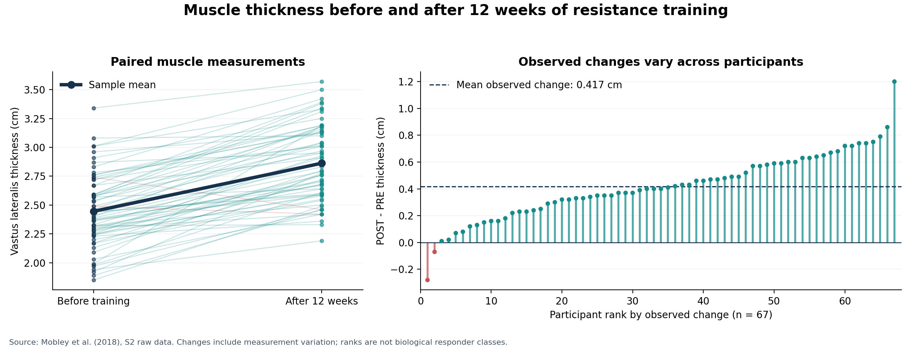
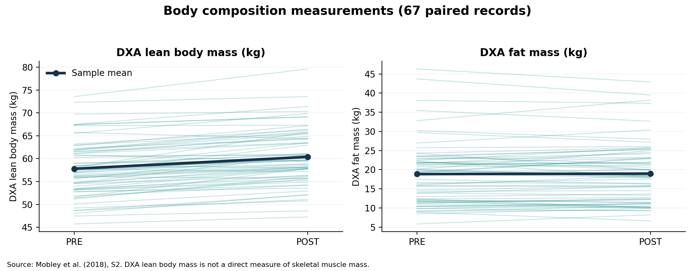
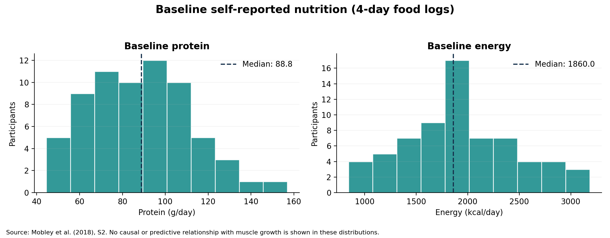

# 增肌项目：清洗与初步描述性分析

阶段：数据准备与描述性分析。尚未拟合预测模型或检验营养与增肌的关联。

## 研究问题

训练前的身体组成、蛋白质和热量摄入，能否在初始肌肉厚度之外，帮助解释和预测 12 周后的肌肉厚度？

## 数据清洗

从原始 Excel 中仅保留 subject 匹配 MPS 加数字的参与者行。排除作者的均值、标准差、计数、检验汇总和图例。保留原始行号和全部原始列，另生成清晰命名的核心数据表。

- 67 名独立参与者，每人一行。
- 六个主要分析字段均完整，主要分析保留 67 人。
- 深蹲力量缺失 3 人，不因这一项删除主要分析样本。
- 未插补、未剔除极值、未将空值填成 0。
- 所有人的厚度差值均与作者已有的 VL Thickness 列一致。

## 实际描述性结果

| 指标 | 有效人数 | 均值 ± 标准差 | 中位数 | 最小值至最大值 |
|---|---:|---|---:|---|
| 训练前股外侧肌厚度 (cm) | 67 | 2.446 ± 0.312 | 2.410 | 1.850 至 3.340 |
| 12 周后股外侧肌厚度 (cm) | 67 | 2.862 ± 0.325 | 2.830 | 2.190 至 3.570 |
| 肌肉厚度变化 (cm) | 67 | 0.417 ± 0.246 | 0.400 | -0.280 至 1.200 |
| 基线蛋白质摄入 (g/day) | 67 | 87.523 ± 24.028 | 88.800 | 44.500 至 157.000 |
| 基线热量摄入 (kcal/day) | 67 | 1920.000 ± 536.781 | 1860.000 | 845.000 至 3183.000 |
| 基线 DXA 瘦体重 (kg) | 67 | 57.781 ± 5.981 | 57.330 | 45.720 至 73.570 |
| 基线脂肪质量 (kg) | 67 | 18.838 ± 8.190 | 18.910 | 5.810 至 46.310 |
| 基线深蹲 3RM (kg) | 64 | 79.733 ± 18.104 | 79.380 | 43.090 至 124.740 |

观察到的肌肉厚度平均变化为 0.417 cm；中位数为 0.400 cm；范围为 -0.28 至 1.20 cm。
其中 65 人测量值增加，2 人减少，0 人未变。不能把减少者直接定义为“无反应者”或“训练无效”。
平均变化的常规 t 法 95% 区间为 0.357 至 0.477 cm。这是样本均值的不确定性区间，不是个人增肌的预测区间，也没有分离测量误差。

## 已固定的主要分析范围

- 主要结局：POST 肌肉厚度（cm）；PRE 肌肉厚度作为基线调整项。
- 四个新增主要特征：PRE DXA 瘦体重、PRE 脂肪质量、PRE 蛋白质 g/day、PRE 能量 kcal/day。
- 先与只有 PRE 厚度的模型比较，再评估四个新增特征是否带来样本外改善。
- 年龄和 supplement_code 分类调整列为预先声明的敏感性分析。深蹲力量为次要探索，不作为主要样本筛选条件。
- POST 营养、累计训练量、POST 生物标志物及作者的增肌聚类标签不进入训练前预测。
- 尚未计算这些特征的关联结果。不能根据描述性分布宣布蛋白质或热量能预测增肌。

## 需要保留的限制

1. 这是一项公开数据二次分析；原论文已经研究增肌反应。本项目可贡献可复现处理、明确的营养/身体组成建模问题及严格验证，不能声称首次发现个体差异。
2. 67 人为选定研究样本，并非一般人群随机抽样；不能外推到女性、老年人或长期训练者。
3. 数据中没有实际体重或身高列，因此暂不计算蛋白质 g/kg 体重、BMI 或身高标准化瘦体重。DXA 瘦体重不等于纯肌肉质量。
4. 原表 T1=PRE，T39=POST。母研究还收集第 6 周饮食，但本附件没有 T20 饮食列；不能伪造中期记录。
5. 营养是时间点前的 4 天自报记录，不能代表整个 12 周摄入。当前查阅材料未明确确认原始 POST 营养数值是否计入补充剂，保持为待核对问题。
6. 补充剂代码为 4、5、6、7、9，数字到补充剂名称的映射未明确；保留为类别代码，不猜测名称、不当作连续数值。
7. 所有组均训练，本附件没有不训练对照组，也没有重复独立训练周期。观察到的变化差异包含真实差异和测量/日常波动，不能直接视为稳定的先天增肌能力。
8. PRE 与 POST-PRE 的相关性存在数学耦合和回归均值问题；主要模型用 POST 结局调整 PRE，变化和百分比变化只作补充解释。
9. 原始部分缺失原因以单元格颜色和图例表示。源文件保留，但当前导出没有逐格解释颜色；核心字段无缺失，分子变量不进入当前主分析。

## 下一步

按照 docs/analysis_protocol.md 拟合基线模型和扩展模型，报告系数及不确定性，开展参与者层面的重复交叉验证；所有预处理和调参只在训练折内完成。负的样本外 R²或未改善的结果也如实记录。

## 来源

1. Mobley et al. (2018), PLOS ONE. https://doi.org/10.1371/journal.pone.0195203
2. S2 原始数据：https://journals.plos.org/plosone/article/file?id=10.1371/journal.pone.0195203.s003&type=supplementary
3. 同一母研究的研究方法：Mobley et al. (2017), Nutrients. https://doi.org/10.3390/nu9090972
4. 原始数据作者使用 CC BY 4.0；本次清洗和描述性分析属于衍生处理，保留原始作者署名与引用。
