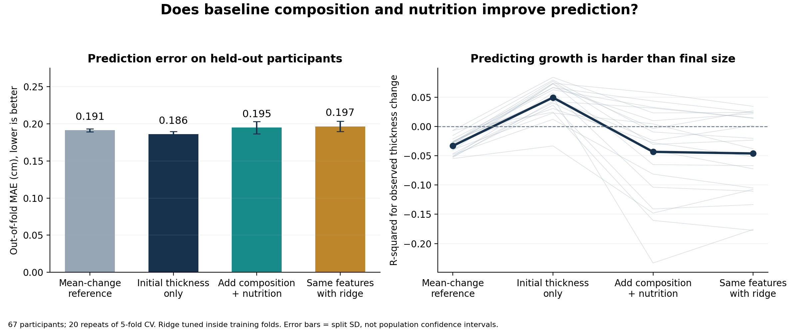
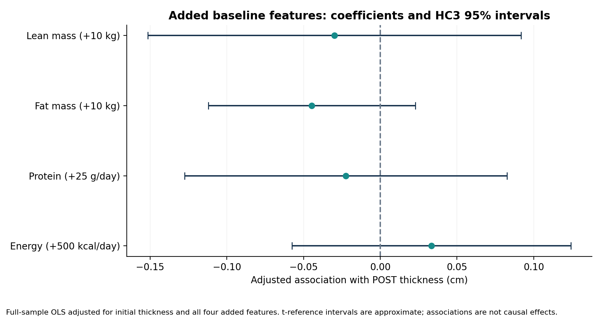
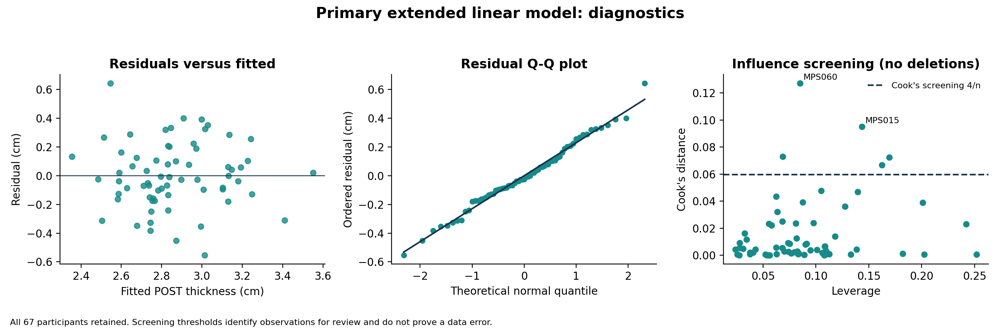

# 第二阶段：基线身体组成与营养是否改善增肌预测？

本报告来自实际运行的模型。67 名参与者全部保留；主要变量与第一阶段方案一致，没有根据结果挑选变量。

## 1. 本次完成的分析

- 关联分析：POST 肌肉厚度为结果，调整 PRE 厚度，并纳入基线瘦体重、脂肪质量、蛋白质和热量。
- 系数使用 HC3 稳健标准误；95% 区间和 p 值采用残差自由度的近似 t 参考。用逐人删除的独立最小二乘拟合验证 HC3 实现。
- 预测分析：同样的 20 次重复 × 5 折交叉验证；每次让全部 67 人各得到一次来自未见过该人的模型的预测。
- Ridge 在外层训练数据内部再做 5 折调参，标准化与调参均不接触外层测试数据。
- 敏感性分析：年龄调整，以及年龄加补充剂代码分类调整。原始数字代码未替换成猜测的补充剂名称。

## 2. 对未参与拟合者的预测结果

表中为每次重复汇总所有留出预测后的指标，再对 20 次取均值。误差单位为 cm。重复次数不增加独立样本量。

| 模型 | MAE 均值 ± 划分标准差 | RMSE 均值 | POST R² 均值 | 观察到的变化 R² 均值 |
|---|---:|---:|---:|---:|
| 训练集 POST 均值参考 | 0.2806 ± 0.0035 | 0.3287 | -0.038 | -0.818 |
| PRE 加训练集平均变化参考 | 0.1913 ± 0.0019 | 0.2479 | 0.410 | -0.033 |
| 只用初始厚度 | 0.1861 ± 0.0035 | 0.2377 | 0.457 | 0.049 |
| 初始厚度 + 身体组成 + 营养 | 0.1949 ± 0.0083 | 0.2489 | 0.404 | -0.043 |
| 相同五个特征 + Ridge 正则化 | 0.1966 ± 0.0068 | 0.2493 | 0.403 | -0.046 |

**本次结论：按照固定特征和验证方案，加入身体组成、基线蛋白质和热量没有改善留出预测，普通线性模型和 Ridge 的平均误差均略大。** 这不等于证明营养没有作用，也不证明这些变量在更大的数据或其他测量设计下没有价值。

加入四个特征的普通线性模型，相比只用初始厚度，平均 MAE 增加 0.0088 cm（0.088 mm）。20 次划分中有 1 次 MAE 更低。
相同特征的 Ridge 模型，平均 MAE 增加 0.0105 cm；20 次中有 0 次 MAE 更低。
这些次数和划分标准差不是独立试验、不是显著性检验，也不是总体性能置信区间。



POST 厚度预测得好，可能主要来自初始肌肉大小。变化 R²则考察 POST-PRE 的预测；它与 POST 的 R²不同。两者的 MAE/RMSE相同，因为实测和预测都减去了同一个人的 PRE 值。负的变化 R²说明该验证误差比用全部样本的真实变化均值作数学参考更大；实际可部署的训练集平均变化参考已另外交叉验证。

## 3. 全样本的条件关联

| 基线特征变化单位 | POST 厚度系数（cm） | 近似 HC3 95% 区间 | 未校正 p 值 |
|---|---:|---|---:|
| 初始厚度 +0.1 cm | 0.0758 | [0.0525, 0.0991] | <0.0001 |
| DXA 瘦体重 +10 kg | -0.0298 | [-0.1515, 0.0918] | 0.6257 |
| 脂肪质量 +10 kg | -0.0446 | [-0.1121, 0.0228] | 0.1909 |
| 蛋白质 +25 g/day | -0.0225 | [-0.1276, 0.0827] | 0.6706 |
| 热量 +500 kcal/day | 0.0333 | [-0.0576, 0.1242] | 0.4663 |

四个新增特征的联合 HC3 Wald F 近似检验 p = 0.5891。该检验用于这批数据的条件关联，并不保证预测改善，更不证明改变饮食会造成对应增肌。
样本内 R² 从基线模型的 0.494 增至扩展模型的 0.516，但验证误差并没有对应改善。新增变量让样本内拟合更好，本身不能作为预测有效的证据。
个别特征的 p 值未作多重比较校正。不要用单个 p 值决定加删变量或宣称发现机制。



## 4. 模型诊断与稳健性

| 特征 | VIF |
|---|---:|
| 初始厚度 +0.1 cm | 1.179 |
| DXA 瘦体重 +10 kg | 1.188 |
| 脂肪质量 +10 kg | 1.014 |
| 蛋白质 +25 g/day | 2.434 |
| 热量 +500 kcal/day | 2.397 |

Cook 距离筛查超过 4/n 的参与者：MPS015, MPS023, MPS028, MPS060, MPS068。
杠杆值超过 2p/n 的参与者：MPS006, MPS010, MPS040, MPS041, MPS091。
筛查标记并不表示数据错误，主要分析没有删除任何人。每次删除一人的系数结果已完整导出，可检查方向和大小是否稳定。



## 5. 预先声明的敏感性比较

下表对基线和扩展模型使用同样的年龄/组别控制。数值为扩展模型减基线模型，MAE/RMSE 负值表示改善。

| 比较 | MAE 差均值（cm） | RMSE 差均值（cm） | POST R² 差均值 |
|---|---:|---:|---:|
| 两者均调整年龄 | 0.0091 | 0.0123 | -0.059 |
| 两者均调整年龄及补充剂类别 | 0.0058 | 0.0104 | -0.051 |

## 6. 结论边界

当前能回答的是：在这批 67 人、这套固定变量和验证方案下，新增信息带来多大的条件关联与预测变化。不能把结果扩展为普遍的蛋白质无效/有效结论。
样本小、自报饮食有误差、没有实际体重列、没有非训练对照、没有外部验证，且群体限于年轻未训练男性。POST 饮食、累计训练量和分子标志物没有放进训练前预测。
本次模型不能用于给个人开增肌处方。统计区间与交叉验证也不能把测量波动分离成稳定的先天增肌体质。

## 7. 如何在你的电脑重现

在解压后的新项目主文件夹打开 PowerShell。如果尚无 .venv 文件夹，先执行 `python -m venv .venv` 创建环境，再依次运行：

```powershell
.\.venv\Scripts\python.exe -m pip install -r requirements.txt
.\.venv\Scripts\python.exe src\run_models.py
```

该脚本先从原始 Excel 重新生成第一阶段结果，然后完成关联、验证、诊断和图表。运行完成会显示 `Complete: association models, nested cross-validation, diagnostics and reports.`。
所有模型指标、划分、留出预测、Ridge 搜索结果和系数保存在 results/models/。

## 来源与署名

原始数据和实验：Mobley et al. (2018), https://doi.org/10.1371/journal.pone.0195203 。原始数据作者不是本项目新脚本的作者。
本项目清洗、关联分析与验证代码为本项目新编写，使用 AI 辅助生成。使用者应理解、审查并如实说明自己的贡献。
HC3 公式：https://www.statsmodels.org/stable/generated/statsmodels.regression.linear_model.OLSResults.HC3_se.html
scikit-learn 验证方法：https://scikit-learn.org/1.8/modules/cross_validation.html

说明：全样本拟合参数用于关联解释；交叉验证误差来自独立留出拟合，不是全样本训练误差。
